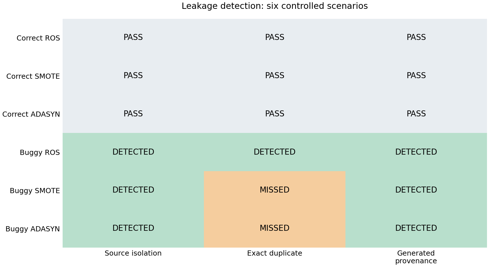
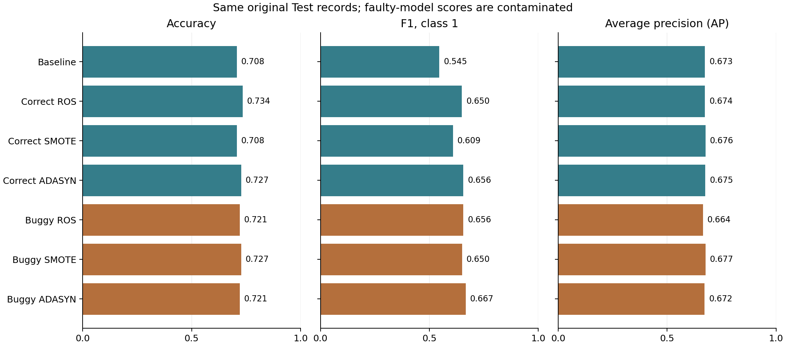

# Oversampling Leakage Testing

A small study of three checks for data leakage in oversampling pipelines.

The question is simple: if a sampler is allowed to use Test data, which checks detect the problem? The project compares correct pipelines with deliberately faulty versions using Random Oversampling (ROS), SMOTE, and ADASYN. A no-sampling baseline is included for model performance.

This is a controlled pilot on one dataset and one split. It is not a general leakage detector or a clinical prediction model.

## Run the project

Use Python 3.12. From this folder:

```bash
python -m venv .venv
source .venv/bin/activate
python -m pip install -r requirements.txt
python run_project.py
```

On Windows, activate with `.venv\Scripts\activate` instead.

The runner checks the dataset, runs the tests, rebuilds the detection reports, evaluates all seven models, and saves the figures. It stops if a step fails. No notebook is required.

The optional static-analysis example can be included with:

```bash
python run_project.py --static
```

The pinned environment uses NumPy 2.3.5, pandas 2.2.3, scikit-learn 1.8.0, imbalanced-learn 0.14.1, pytest 9.0.2, and matplotlib 3.10.8. Tracing should be checked again before changing library versions.

## Experimental setup

- Pima Diabetes: 768 records, eight predictors, and binary `Outcome`.
- One stratified 80/20 split: 614 Train records and 154 Test records, seed 42.
- Zero values in five measurement columns are treated as missing.
- Median imputation and standard scaling are fitted on Train only in every version.
- The classifier is `LogisticRegression()` with default parameters and a 0.5 decision threshold. There is no hyperparameter or threshold tuning.
- Seven evaluations: baseline, three correct sampling pipelines, and three faulty sampling pipelines.

The mutation changes the **sampler's input**:

| Version | Sampler input | Classifier training data |
|---|---|---|
| Correct | Original Train only | Resampled Train |
| Faulty | All 768 original records and labels | Original Train plus the sampler's added rows |

All evaluations use the same original 154 Test records. The faulty condition is not the usual “resample, then split” experiment: the split is fixed first, and only added copies or synthetic rows are appended to Train. These added rows can still carry Test information.

This is **one fault family applied to three samplers**, not three independent fault types. See [the method](docs/METHOD.md) for details.

## Checks and expected results

An oracle is a rule used to judge a particular property of the pipeline.

| Check | What it checks | Main limitation |
|---|---|---|
| Source Isolation | Recorded sampler-input IDs do not overlap Test IDs. | Needs reliable input provenance. |
| Exact Duplicate | Added feature rows do not exactly match a Test feature row. | Different sources can have equal values; synthetic rows may have no exact match. |
| Generated Provenance | Added rows have no direct parent from Test. | Needs parent tracing and does not cover every indirect influence. |

For the supplied data and fixed split:

| Pipeline | Source Isolation | Exact Duplicate | Generated Provenance |
|---|---|---|---|
| Correct ROS | PASS | PASS | PASS |
| Correct SMOTE | PASS | PASS | PASS |
| Correct ADASYN | PASS | PASS | PASS |
| Buggy ROS | DETECTED | DETECTED | DETECTED |
| Buggy SMOTE | DETECTED | MISSED | DETECTED |
| Buggy ADASYN | DETECTED | MISSED | DETECTED |

`DETECTED` and `MISSED` refer to the injected sampler-access fault. `PASS` means no violation was flagged for that check. A passing pytest test can mean that a deliberate fault was detected as expected.

Each faulty sampler receives all 154 Test IDs. The added rows with at least one direct Test parent are **54 for ROS, 78 for SMOTE, and 88 for ADASYN**. These are row counts, not counts of distinct Test records. They depend on the data, split, and implementation.

Two extra cases probe the limits of the checks:

1. ROS sees all records, but Test-origin copies are removed. Source Isolation flags the access; the retained-parent check passes its narrower rule.
2. Independently identified Train and Test records have identical features. Exact Duplicate flags a match even though the sampler used only Train.

## Outputs

The runner writes CSV tables to `results/` and plots to `figures/`. The main reports are:

- `detection_matrix.csv`: the six sampling scenarios and three checks.
- `leakage_evidence.csv`: input overlap, added rows, and direct-parent counts.
- `oracle_metrics.csv`: descriptive counts for these six scenarios only.
- `pilot_model_performance.csv`: accuracy, precision, recall, F1, balanced accuracy, ROC AUC, and Average Precision (AP) for seven models.
- `predictions.csv` and `confusion_matrices.csv`: per-record predictions and the counts behind the classification scores.
- `run_metadata.json`: dataset identity and environment information.

Local logs are saved on each run and are excluded from version control.

Model scores are secondary evidence. Leakage need not produce a large score increase. Training sizes and class balances also differ, so score changes do not isolate the causal effect of leakage. Scores from faulty models are not independent estimates of generalization.





## Files to read

| File | Role |
|---|---|
| `pipelines.py` | Data preparation, reference pipelines, deliberate faults, and parent tracing. |
| `oracles.py` | Reusable source-overlap and exact-value checks. |
| `detection_matrix.py` | Apply the same checks to the six sampling scenarios. |
| `evaluate_models.py` | Evaluate the seven model runs. |
| `plot_results.py` | Plot the saved reports. |
| `test_*.py` | Check expected behavior, tracing, and edge cases. |
| `static_leakage.py` | Optional, limited AST-based warning example. |
| [Method](docs/METHOD.md) | Exact protocol and claim limits. |
| [Code guide in Persian](docs/CODE_GUIDE_FA.md) | Short walkthrough and meeting questions. |
| [References](docs/REFERENCES.md) | Dataset background, sampling methods, and documentation. |

## Limitations

The input metadata is partly constructed by the experiment functions. Source Isolation is therefore not yet an independent observer that can be attached to an arbitrary notebook. ROS parents come from sampler indices; SMOTE uses an internal tracing hook; ADASYN parents are replayed and checked against the generated rows.

Reliable source identity and parent records are essential for two of the checks. The direct-parent check does not represent every influence on generation, including ADASYN's difficulty estimates. A future observer should distinguish a valid trace from a missing or invalid one rather than treating missing evidence as a pass.

The results cover one dataset, one seed, and one fault family. The small scenario counts are not estimates of detection performance on unseen projects. Independent recording of actual sampler inputs and a broader set of valid controls and faults are planned, not implemented here.

The exact download source of the supplied CSV was not recorded. Its SHA-256 is `b78029447fae2743b3218bb2b76ef0d04afe8d7e55ce2faf4d1ec82d8f8ae8ac`. OpenML 37 documents the Pima dataset's UCI origin; this does not establish that the CSV is an official OpenML export. See the dataset note in [References](docs/REFERENCES.md).
